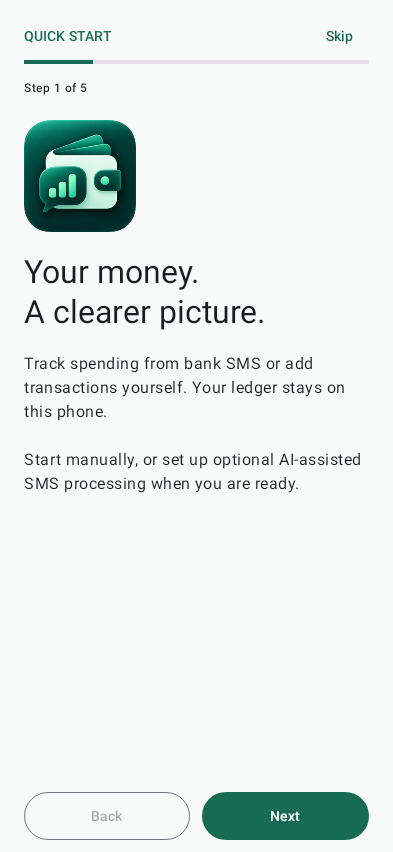
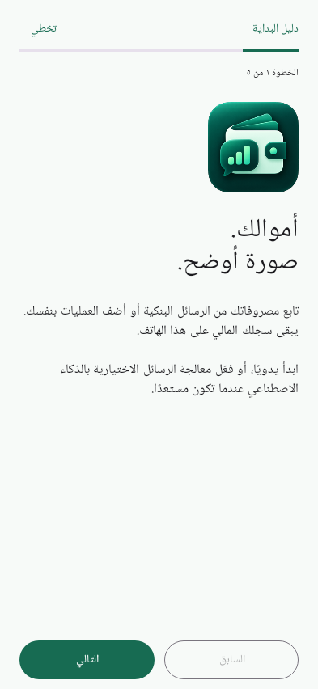
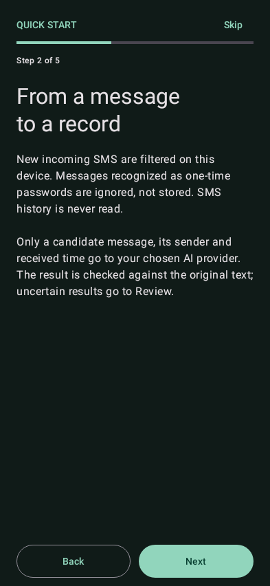
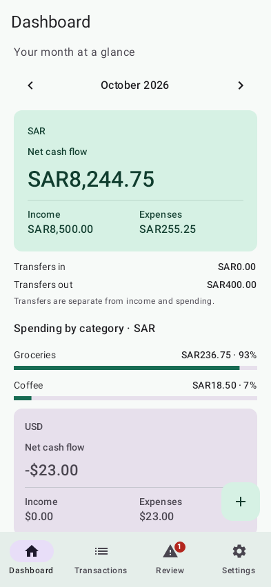
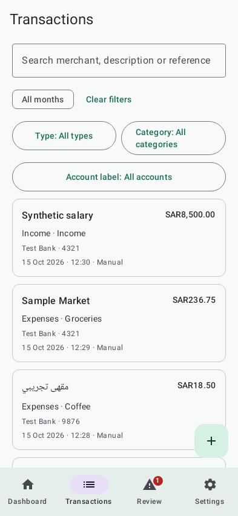
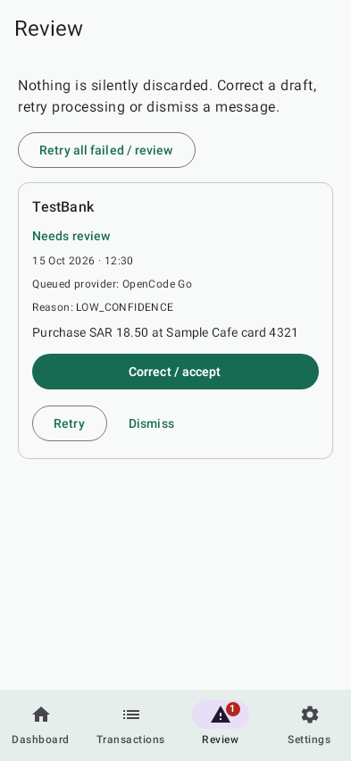

# Personal Finance for Android

A personal-project spending ledger built with Kotlin and Jetpack Compose Material 3. Track manual entries and optionally extract transactions from incoming bank SMS using your own AI-provider key. English and Arabic (RTL), light and dark themes. Android 8.0+ (API 26); version 1.1.0.

This is experimental software, not financial advice or a bank balance tracker. Builds are debug-signed. There is no Play Store release or downloadable binary release here. Automated JVM tests and synthetic UI renders are available; installation, background SMS reception, restricted-permission grants and Android Keystore behavior have not been verified on a physical device by the author's tooling. Live provider inference has not been tested with a real key.

## Features

- First-launch tutorial with Skip, Back, Next and Finish; replay it from Settings → Show tutorial.
- Monthly dashboard with separate currency totals, category shares and recent activity. Transfers are separate from income/expenses/net; no FX conversion or bank-balance estimate.
- Manual add/edit/delete, search and filters, category management and duplicate warnings. Manual use needs neither SMS permission nor an API key.
- Durable incoming-SMS queue with offline retention, bounded retries and conservative validation. Uncertain extractions go to Review for correction, retry or confirmed dismissal.
- Independent OpenCode Go, OpenRouter and Custom provider configurations. No automatic fallback; reassignment of queued messages needs confirmation.

## Screenshots

These are Robolectric/Roborazzi renders from a separate test host using fabricated records, not real account data or device screenshots. The actual app uses `FLAG_SECURE`.

| Tutorial (English) | Tutorial (Arabic / RTL) | Tutorial (dark) |
| --- | --- | --- |
|  |  |  |

| Dashboard | Transactions | Review |
| --- | --- | --- |
|  |  |  |

## Privacy and data flow

Manual records stay in an app-private Room database on this phone. Optional SMS extraction is NOT entirely on-device:

1. After you explicitly grant incoming-SMS permission, multipart messages are joined and filtered locally. Messages recognized as OTPs or unrelated are counted without storing their bodies. Filtering is heuristic and cannot guarantee every sensitive message is recognized; leave SMS permission disabled if this risk is unacceptable.
2. A candidate's sender, body and received timestamp are saved locally before processing. Candidate bodies and sender addresses can contain financial and personal information; they are not redacted before extraction.
3. When connectivity and a configured key are available, one candidate at a time is sent to the selected external AI provider, with extraction instructions and category keys. Other ledger records are not included. Your key is sent as the provider's authorization header. The provider also sees normal network metadata; its own retention and privacy terms apply.
4. Results are checked against the source text. Ambiguous amounts, unsupported dates, low confidence and other mismatches go to Review. This does not guarantee correctness: check your ledger before relying on it.

API keys are masked in the UI and encrypted at rest using Android Keystore-backed AES-GCM. The database itself is not separately encrypted; Android app isolation/device security still matter. Backup and device-transfer rules exclude app data, cleartext traffic is disabled, and `FLAG_SECURE` blocks normal screenshots/recents previews. There is no analytics, account sign-in, hosted ledger or sync service. These protections do not defend a compromised/rooted phone.

Queued SMS and dismissed entries remain stored; dismissal is not erasure. There is no bulk data-export/delete UI. Android's Clear storage or uninstall removes app-private records and settings; data recovery is not provided. Removing a saved provider key does not revoke it at the provider. Never share keys, real SMS, database files or personal screenshots in issues or pull requests.

## Permissions

- `INTERNET`: provider requests; WorkManager also merges network/wake permissions needed for scheduling.
- `RECEIVE_SMS`: optional, requested only from Settings after the external-provider disclosure. No `READ_SMS` or inbox-history import, notification listener or accessibility ingestion.
- The incoming receiver requires the platform's `BROADCAST_SMS` permission. The tutorial itself requests no permissions and sends no requests.

On Android 13+, sideloaded apps may require App info → menu → Allow restricted settings before SMS permission can be granted. Device, installer or administrator policy can still block access; the option is not guaranteed on every phone. Settings includes Open app settings. Denying SMS does not prevent manual use.

## Provider setup

Create a dedicated key for this app, review your provider's terms, then open Settings:

1. Choose a provider and model:
   - OpenCode Go: fixed `https://opencode.ai/inference/go/openai/v1/chat/completions`, default model `glm-5.3-flash`.
   - OpenRouter: fixed `https://openrouter.ai/api/v1/chat/completions`; enter an available model ID.
   - Custom: enter a full HTTPS OpenAI-compatible Chat Completions URL and model. Embedded URL credentials, queries and fragments are rejected. HTTP loopback configuration is permitted only for JVM tests; Android cleartext remains disabled.
2. Enter your API key. A blank field preserves a saved key. Remove saved key takes effect on Save.
3. Test connection sends only a minimal `Reply with OK.` prompt using the displayed form; it does not save the form and may incur a provider charge.
4. Save persists and activates that provider. Messages queued for another provider stay tied to it until you confirm reassignment in Review.

Requests use `User-Agent: AlomairFinance/1.0 (Android)`; OpenCode Go also receives a stable app-generated `x-opencode-session` identifier. There are no embedded credentials.

OpenCode Go eligibility caveat: [its documentation](https://opencode.ai/docs/go/) describes a service designed for coding agents. SMS finance extraction is not coding-agent traffic and may be ineligible, blocked or throttled. The preset is not an assurance of permission or compatibility. Check current terms, model availability and limits before using it; choose another provider only explicitly. No live compatibility claim is made.

## Build from source

Prerequisites: Git, JDK 17 and Android SDK with platform 34 and build-tools 34.0.0, with SDK licenses accepted. Set `JAVA_HOME` and `ANDROID_HOME` to your installations (or set `sdk.dir` in an untracked `local.properties`). No Android Studio is required for command-line builds. Public Gradle/Maven dependencies require network access on a first build.

```sh
git clone https://github.com/aalomair/personal-finance-android.git
cd personal-finance-android
./gradlew assembleDebug testDebugUnitTest lintDebug
```

For a clean verification: `./gradlew --no-daemon clean assembleDebug testDebugUnitTest lintDebug`.

The APK is `app/build/outputs/apk/debug/app-debug.apk`, signed with a local debug key, not a production signing identity. Transfer it to a test phone permitting sideloading; no device install is performed by the build. Never commit a keystore, APK, `local.properties` or provider key. This repository supplies a POSIX `gradlew`; on Windows use a POSIX shell with JDK 17.

Pins: Gradle 8.7 (official wrapper and distribution SHA-256), AGP 8.4.2, Kotlin 1.9.22, Compose compiler 1.5.10 / BOM 2024.06.00, Room 2.6.1, WorkManager 2.9.0 and OkHttp 4.12.0. These are deliberate reproducibility pins, not a claim that they are the latest versions.

## Testing and contributing

JUnit/Robolectric tests exercise Room CRUD/uniqueness, exact money math, Arabic/English extraction grounding, queue retries and consent, mocked request privacy, AES-GCM isolation, synthetic multipart SMS, manual-only UI navigation and tutorial persistence/replay. Network tests use loopback MockWebServer and dummy keys, never real providers. JVM encryption tests use ephemeral software AES keys, not the real Android Keystore.

Reports: `app/build/test-results/testDebugUnitTest/` and `app/build/reports/lint-results-debug.html`. Tests record synthetic renders into `app/build/screenshots/`, including English, Arabic, dark, a small phone at 1.3× text and tablet layouts. These are not pixel-baseline assertions or physical-device, TalkBack or keyboard testing.

Keep changes focused, run the clean verification command and use only invented fixtures (Synthetic/Test/Demo banks, sample merchants, short dummy account suffixes and `SYN` references). Report security problems privately as described in [SECURITY.md](SECURITY.md). General bug reports should include Android version and sanitized reproduction steps, never real financial data.

The untouched supplied icon is at `docs/brand/icon-source.png`; `tools/generate_icons.py --evidence <output-directory>` reproduces the adaptive/legacy assets and a mask preview (Python 3 with Pillow needed only for this optional tool). Do not replace it with unrelated artwork.

## License

[MIT](LICENSE), copyright 2026 aalomair. Third-party tools and dependencies retain their own licenses; see [NOTICE.md](NOTICE.md).
